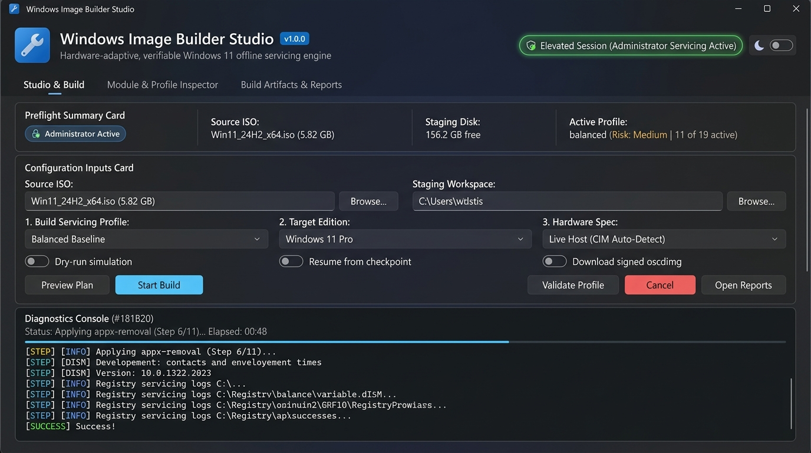

# WIB: Windows Image Builder (v0.2.29)

A manifest-driven PowerShell engine for planning, customizing, and auditing Windows installation media offline.

[](LICENSE)
[](docs/COMPATIBILITY.md)
[%20%7C%2011%20(21H2--26H2)-blue.svg)](docs/COMPATIBILITY.md)
[%20%7C%20Server%202022%2F2025-blue.svg)](docs/COMPATIBILITY.md)

---

## Status at a Glance

* **Version:** `0.2.29`
* **Authoritative CLI:** [`build.ps1`](build.ps1)
* **Runtime Support:** Windows PowerShell 5.1 (native desktop engine, pure ASCII, zero third-party module dependencies) and PowerShell 7.4+ on Windows 10/11.
* **Automated Test Evidence:**
  * **655/655 assertions passing** across 51 test suites in [`tests/smoke.ps1`](tests/smoke.ps1).
  * **22/22 behavioral gates passing** (`G1`–`G22`) in [`tests/verify-gates.ps1`](tests/verify-gates.ps1).
* **Independent Software:** WIB is an independent open-source project and is not affiliated with, sponsored by, or endorsed by Microsoft Corporation. WIB does not bundle or distribute Windows installation media. You must supply legitimate Windows installation media obtained directly from Microsoft.

---

## What is Windows Image Builder?

**Windows Image Builder (WIB)** lets you create clean, fast, and bloat-free Windows 11 installation media (ISO or USB) **before** you install Windows on your PC.

Instead of installing Windows and then spending hours manually uninstalling junk apps, disabling telemetry, or running risky scripts on your live computer, WIB customizes the official Windows installer directly. When your installation finishes, your computer boots into an optimized, private, and responsive Windows desktop from day one.

### Why is WIB Better Than Traditional "Debloat" Scripts?

* **Safe & Isolated (Offline vs. Live):** Most debloat tools run directly on your active Windows desktop. If a script removes the wrong component or corrupts a registry key, your system can break, become unstable, or fail future Windows Updates. WIB modifies installation media *offline* in an isolated temporary workspace—your actual computer is never modified or put at risk during the build.
* **Never Breaks Core Subsystems:** Aggressive debloaters often break the Microsoft Store, Windows Security (Defender), Xbox Game Pass, or Windows Update. WIB includes strict built-in safeguards that protect critical OS dependencies (`Microsoft.WindowsStore`, `winget`, `SecHealthUI`, `WebView2`) by default.
* **Preview Every Change First (Zero Guesswork):** You never have to guess what will change. Running a dry-run (`.\build.ps1 -Command plan`) generates an exact preview of every package, feature, and registry tweak scheduled for modification before changing a single byte.
* **Reversible & Auditable:** Every registry tweak is recorded in an in-image undo journal (`journal.reg` and `journal.json`). You can review, audit, or reverse any setting at any time using [`tools/WibPanel.ps1`](tools/WibPanel.ps1). If a build is ever interrupted, transactional WIM checkpoints restore a clean state automatically.
* **100% Native & Transparent:** WIB is pure PowerShell built exclusively on official Microsoft utilities (`dism.exe`, `reg.exe`, and `oscdimg.exe`). There are zero closed-source executables, mystery background services, or untrusted binary wrappers.

---

## System Requirements

| Requirement | Specification | Details |
| :--- | :--- | :--- |
| **Host OS** | Windows 10 (21H2+) or Windows 11 (26H2 latest & recommended) x64 | Elevated Administrator prompt required for DISM filter drivers and registry hive mounting (`reg.exe load`). |
| **PowerShell Engine** | Windows PowerShell 5.1 or PowerShell 7.4+ | 100% native PS 5.1 compatible. Zero external PSGallery module dependencies. |
| **Target Images** | Windows 11 (21H2–26H2, with 26H2 latest & recommended) x64/ARM64, Windows Server 2022/2025 Desktop Experience | Official Microsoft ISO or WIM source. |
| **Disk Space** | 25–40 GB free temporary storage | Required on the scratch drive for WIM index extraction, staging, and ISO authoring. |
| **Image Authoring** | `oscdimg.exe` (v2.56+) | Sourced from Windows ADK Deployment Tools or the verified download cache (`-DownloadOscdimg`). |

For full compatibility details, see [`docs/COMPATIBILITY.md`](docs/COMPATIBILITY.md).

---

## How to Use WIB: Beginner's Step-by-Step Guide

Whether you prefer a modern graphical desktop app, an interactive terminal menu, or automated PowerShell commands, WIB makes creating clean Windows installation media simple, safe, and transparent.

---

### Quick Start: 3 Minutes to Your First Custom ISO

If you are new to image building, here is the fastest way to get started:

1. **Download & Extract WIB:** Download the project ZIP from GitHub and extract it to `C:\WIB`.
2. **Download Windows 11:** Get the official Windows 11 multi-edition ISO directly from [Microsoft](https://www.microsoft.com/software-download/windows11).
3. **Launch WIB Studio:** Double-click **`launch-gui.cmd`** in your `C:\WIB` folder (click **Yes** when Windows asks for Administrator permission).
4. **Select Your ISO & Profile:**
   * Click **Browse...** on *Source ISO Image* and pick your downloaded Windows 11 ISO.
   * Ensure *Build Profile* is set to **`balanced`** (the gold standard for daily PCs).
5. **Build:** Click **Preview Plan** to review what will change, then click **Start Build**!

When the build finishes, your optimized, bloat-free ISO is ready in your `C:\WIB` folder.

---

### Detailed Step-by-Step Guide

#### Step 1: Download and Extract WIB

1. **Option A (GitHub ZIP Download):**
   * Download the repository ZIP file from the green **Code** button on GitHub.
   * Extract the ZIP archive into a fast local drive, such as `C:\WIB`.
   * *Tip:* Avoid extracting to OneDrive-synced folders, network drives, or folders with special symbols to ensure maximum DISM file-system performance.
2. **Option B (Git Clone):**
   ```powershell
   git clone https://github.com/moalimjaveed/WIB-Windows-Image-Builder.git C:\WIB
   cd C:\WIB
   ```

#### Step 2: Download the Official Windows 11 ISO

Always use legitimate installation media obtained directly from Microsoft:

1. Visit Microsoft's official download page: [Download Windows 11](https://www.microsoft.com/software-download/windows11).
2. Under **Download Windows 11 Disk Image (ISO)**, select **Windows 11 (multi-edition ISO)** and download your preferred language.
3. Save the file to your computer (for example, `C:\ISOs\Win11_English_x64.iso` or directly into `C:\WIB`).

---

### Step 3: Choose How to Launch WIB (3 Easy Ways)

WIB provides three distinct ways to run, depending on your preferred workflow:

#### Option 1: Desktop GUI Studio (`launch-gui.cmd`) &mdash; *Easiest & Most Intuitive*

No commands to type&mdash;everything is controlled through an authentic **Windows 11 Fluent 2** desktop application with Mica material glass, rounded cards, real-time dark diagnostics console, and integrated module catalog:



* **For Full Builds (Elevated Servicing Mode):**
  * Double-click **`launch-gui.cmd`** in the `C:\WIB` folder.
  * Windows will ask for Administrator permission (UAC). Click **Yes**.
* **For Safe Previews (No Admin Prompt Needed):**
  * If you just want to look around, inspect profiles, or test features without elevating:
  * Open PowerShell and run:
    ```powershell
    .\tools\launch-gui.ps1 -NoElevate
    ```
    *(or `.\build.ps1 -Gui -NoElevate`)*

##### Guided Walkthrough of the Studio Interface:

| Control / Setting | What It Does | Recommended Choice |
| :--- | :--- | :--- |
| **Source ISO Image** | The clean Windows 11 ISO file you downloaded from Microsoft. | Click **Browse...** and select your `.iso` file. |
| **Staging Workspace** | Temporary scratch folder where image files are mounted and serviced. | Leave as default (`C:\WIB\work`). Requires 25–40 GB free space on NTFS. |
| **Build Profile** | The preset that determines which bloatware, services, and telemetry to trim. | **`balanced`** for everyday workstations; **`lean`** for gaming rigs & VMs. |
| **Target Edition** | Selects which Windows edition inside the ISO to customize (Pro, Home, Enterprise). | **Auto-detect (Single Edition)** or select your specific edition index. |
| **Hardware Profile** | Adapts optimizations to your processor, RAM, and graphics capabilities. | **Live Host (CIM Auto-Detect)** to match your current machine. |
| **Dry-run simulation only** | Tests the entire pipeline in ~10 seconds without writing changes to disk. | Check this box if you want a zero-risk dry run before your real build. |
| **Download signed oscdimg** | Downloads and verifies Microsoft's official ISO packager if ADK is not installed. | Leave checked (recommended). |
| **Resume from checkpoint** | Resumes a build if your PC lost power or restarted during a previous run. | Unchecked for fresh builds; check if recovering an interrupted build. |
| **Preview Plan** button | Generates a complete diagnostic manifest showing all planned package removals. | Click to review before building. |
| **Start Build** button | Launches the offline servicing engine and creates your finalized ISO. | Click when you are ready to produce the new ISO. |

---

#### Option 2: Interactive Terminal Menu (`build.cmd`) &mdash; *Simple Console Menu*

1. Double-click **`build.cmd`** (or right-click and choose **Run as administrator**).
2. A status dashboard opens displaying your session privileges and available profiles:
   ```text
   ================================================================================
     WIB: Windows Image Builder (v0.2.29)
     Hardware-adaptive, verifiable Windows 11 offline servicing engine
   ================================================================================
     Session:    Elevated (Administrator Servicing Active)
     Profiles:   adaptive, balanced, custom-risk, hardening, lean

     QUICK START / CLI USAGE:
     1. Launch Desktop GUI:      .\build.ps1 -Gui       (or .\launch-gui.cmd)
     2. Validate a Profile:      .\build.ps1 -Command validate -ProfileName balanced
     3. List Registered Modules: .\build.ps1 -Command list
     4. Preview Execution Plan:  .\build.ps1 -IsoPath "D:\Win11.iso" -Command plan
     5. Execute Full Build:      .\build.ps1 -IsoPath "D:\Win11.iso" -ProfileName balanced
   --------------------------------------------------------------------------------
     Options: [G] Launch WIB Studio GUI | [V] Validate Profile | [L] List Modules | [Enter] Exit
   ```
3. Press **`G`** to launch the GUI, **`V`** to test profile validity, **`L`** to list modules, or **`Enter`** to exit.
4. *Built-in crash protection:* `build.cmd` automatically pauses on completion or error so the window never disappears before you read the output.

---

#### Option 3: PowerShell Command Line (`build.ps1`) &mdash; *Power Users & Automated Scripts*

Open **Windows PowerShell** as Administrator (press `Win + X` &rarr; select **Terminal (Admin)** or **Windows PowerShell (Admin)**):

```powershell
cd C:\WIB
```

##### 1. Inspect Servicing Modules (No ISO Needed)
Lists all 19 servicing modules, risk tiers, and reversibility mechanisms:
```powershell
.\build.ps1 -Command list
```

##### 2. Validate Profiles (No ISO Needed)
Validates profile syntax, inheritance hierarchy, and JSON schema rules:
```powershell
.\build.ps1 -Command validate -ProfileName balanced
```

##### 3. Preview Execution Plan (Dry-Run Preview)
Mounts the image in a sandbox, evaluates all package removals, writes a preview report, and dismounts cleanly:
```powershell
.\build.ps1 `
    -IsoPath "C:\ISOs\Win11_English_x64.iso" `
    -ProfileName balanced `
    -Command plan
```

##### 4. Execute Full Image Build
Runs the complete offline servicing pipeline and generates a bootable ISO:
```powershell
.\build.ps1 `
    -IsoPath "C:\ISOs\Win11_English_x64.iso" `
    -ProfileName balanced `
    -OutputIso "C:\ISOs\Win11_Custom_Balanced.iso"
```

---

### Command Line Parameter Reference

| Parameter | What It Does | Example Value | Required? |
| :--- | :--- | :--- | :--- |
| **`-IsoPath`** | Full path to the clean Windows 11 source ISO file. | `"C:\ISOs\Win11_26H2.iso"` | Yes (for build and plan) |
| **`-ProfileName`** | The customization profile preset to apply (`balanced`, `lean`, `adaptive`, `hardening`, `custom-risk`). | `balanced` | No (defaults to `balanced`) |
| **`-OutputIso`** | File path where your finished customized ISO will be saved. | `"C:\ISOs\Win11_Custom.iso"` | Recommended for builds |
| **`-Command`** | Operation: `build` (default), `plan` (preview), `validate` (schema check), or `list` (show modules). | `build`, `plan`, `validate`, `list` | No (defaults to `build`) |
| **`-Gui`** | Launches the desktop graphical user interface directly from the CLI. | Switch flag: `-Gui` | Optional |
| **`-NoElevate`** | Runs GUI or validation without prompting for UAC elevation (preview mode). | Switch flag: `-NoElevate` | Optional |
| **`-WorkDir`** | Custom folder for temporary image mounting and servicing files. | `"D:\Scratch\WibWork"` | No (defaults to `.\work` on NTFS) |
| **`-DownloadOscdimg`** | Downloads and cryptographically verifies official Microsoft `oscdimg.exe`. | Switch flag: `-DownloadOscdimg` | Optional |
| **`-ExpectedIsoSha256`** | SHA-256 hash to verify the source ISO has not been corrupted or tampered with. | `"5A1B2C..."` | Optional |
| **`-DryRun`** | Alias for `-Command plan` (generates execution report without saving changes). | Switch flag: `-DryRun` | Optional |
| **`-Resume`** | Resumes an interrupted servicing run from its last verified checkpoint. | Switch flag: `-Resume` | Optional |

---

### Step 4: Testing & Installing Your Custom Windows

1. **Always Test in a Virtual Machine First (Recommended):**
   * Before installing on physical hardware, create a temporary VM in **Hyper-V**, **VirtualBox**, or **VMware Player**.
   * Mount your newly generated ISO file (e.g. `Win11_Custom_Balanced.iso`) as the virtual optical drive.
   * Boot the VM and verify that Windows Setup completes smoothly to the desktop.
2. **Flash to a USB Flash Drive for Physical PC Installation:**
   * **Using Rufus:**
     * Download [Rufus](https://rufus.ie/).
     * Select your USB flash drive (8 GB+).
     * Choose your new custom ISO file.
     * Click **START** to write the installer to the USB drive.
   * **Using Ventoy:**
     * Install [Ventoy](https://ventoy.net/) onto your USB drive.
     * Simply copy your new custom `.iso` file directly onto the Ventoy USB drive.
3. **Boot & Install:**
   * Plug the USB drive into your PC, enter your BIOS/UEFI boot menu (usually `F12`, `F11`, or `Del`), boot from the USB drive, and enjoy your clean, fast Windows 11 installation!

---

### Beginner FAQ & Troubleshooting

<details>
<summary><strong>Q: Why do live builds require Administrator permissions?</strong></summary>

Windows offline servicing uses official Microsoft DISM filter drivers (`wimmount.sys`) and registry hive mounting (`reg.exe load`). These operating system servicing APIs require kernel-level filesystem privileges to mount and unpack WIM images. **WIB never alters your host computer**&mdash;it only uses servicing privileges inside the temporary staging folder (`.\work`).
</details>

<details>
<summary><strong>Q: Can I run WIB without Administrator permissions?</strong></summary>

Yes! You can run in **Preview Mode** without any admin prompt. Just launch `.\tools\launch-gui.ps1 -NoElevate` or run `.\build.ps1 -Command validate -ProfileName balanced`. You can inspect all 19 servicing modules, view profile trade-offs, and check schemas with standard user rights.
</details>

<details>
<summary><strong>Q: Does this break the Microsoft Store, Xbox, or Windows Update?</strong></summary>

**No.** Unlike crude internet debloat scripts that aggressively rip out system packages, WIB enforces hard architectural safety invariants:
* The Microsoft Store (`Microsoft.WindowsStore`) and `winget` package manager are strictly preserved.
* Xbox Identity Provider and gaming frameworks remain fully operational.
* Windows Update and Component Store servicing integrity are preserved so future security updates install cleanly.
</details>

<details>
<summary><strong>Q: What if my computer shuts down or the build is interrupted?</strong></summary>

WIB includes a transactional checkpoint system. If a build is interrupted, simply launch WIB again and check the **Resume from checkpoint** option (or pass `-Resume` on the command line). WIB will verify disk integrity and resume directly from the last successful servicing stage without starting over.
</details>

<details>
<summary><strong>Q: Where is my finished ISO saved?</strong></summary>

By default, the finished ISO is saved directly in your WIB project folder with the name `wib-<profile>-<date>-<id>.iso` (for example: `wib-balanced-20261010-A1B2C3D4.iso`). In the GUI, you can also specify a custom destination path in the *Custom Output ISO* field.
</details>

---

## Built-in Profiles

| Profile | Target Scenario | AppX Packages | Telemetry / Diagnostics | Security Controls | Rollback Scope |
| :--- | :--- | :--- | :--- | :--- | :--- |
| **`balanced`** | Workstations & daily use | Removes consumer bloat | Configured to Basic / Required (`AllowTelemetry = 1`) | Preserved intact | In-image registry journal (`journal.reg`); AppX re-installable via Store |
| **`lean`** | Lab VMs & high-performance | Strips non-essential inbox apps | Minimized per edition policy | Preserved intact | In-image registry journal; AppX re-installable via Store |
| **`adaptive`** | Hardware-aware baseline | Dynamic package selection | Tuned to detected hardware | Preserved intact | In-image registry journal |
| **`hardening`** | High-security & compliance | Minimal attack surface | Auditing & restrictive baselines | Enhanced defensive policies | In-image registry journal |
| **`custom-risk`** | Isolated research environments | Aggressive package removal | Experimental | High-impact opt-ins (requires `-AcceptRisk`) | Partial / Advanced |

---

## Security, Credentials & Operational Boundaries

1. **Unattended Credentials Disclosure:**  
   Microsoft Windows Setup answer files (`autounattend.xml`) store passwords in reversible Base64 obfuscation (`<PlainText>false</PlainText>`), **not cryptographic encryption**. Anyone with read access to the installation media or the answer file can decode the password.  
   * WIB copies credentials directly from unmanaged memory buffers (`SecureStringToGlobalAllocUnicode`) to minimize CLR string retention during XML assembly.  
   * **Always use unique, temporary setup credentials.**  
   * Never commit answer files to public repositories.  
   * Rotate or delete the initial local administrator account immediately after installation.
2. **Handle-Bound File Security:**  
   WIB implements kernel handle-bound deletions and strict DACL inheritance verification (`Protect-WibSensitiveFileAcl`) on recovery ledgers (`recovery-state.json`) and answer files to defend against concurrent path redirection and unowned file substitution.
3. **High-Impact Controls Require Explicit Opt-In:**  
   Features that disable security controls (such as UAC prompt suppression or core isolation alterations) are strictly segregated and require the `-AcceptRisk` switch.
4. **Isolated Servicing:**  
   WIB operates exclusively on offline image mounts. It makes no configuration changes to your running host operating system.

---

## Verification & Test Evidence

Run the automated test suites from an elevated PowerShell session:

```powershell
# Run all 51 smoke test suites (655 assertions)
powershell.exe -NoProfile -ExecutionPolicy Bypass -File .\tests\smoke.ps1

# Run all 22 behavioral release gates (G1 through G22)
powershell.exe -NoProfile -ExecutionPolicy Bypass -File .\tests\verify-gates.ps1 -Gate All
```

> [!NOTE]
> Passing automated tests validates parser correctness, registry injection logic, recovery mechanics, and file security. It does not substitute for end-to-end VM boot and OOBE validation.

---

## Project Documentation

* [Getting Started Guide](docs/GETTING_STARTED.md) &mdash; Detailed installation, ISO acquisition, and VM test instructions.
* [Compatibility Matrix](docs/COMPATIBILITY.md) &mdash; Host OS, target builds, and architectural boundaries.
* [GitHub Launch & SEO Checklist](docs/GITHUB_AND_SEO_LAUNCH_CHECKLIST.md) &mdash; Repository configuration, metadata, and launch guide.
* [Contributing Guide](CONTRIBUTING.md) &mdash; Coding conventions, PowerShell 5.1 compatibility, and PR workflow.
* [Security Policy](SECURITY.md) &mdash; Vulnerability disclosure and security scope.
* [Code of Conduct](CODE_OF_CONDUCT.md) &mdash; Contributor Covenant v2.1.
* [Changelog](CHANGELOG.md) &mdash; Version history and release notes.

---

## License & Attribution

This project is licensed under the [MIT License](LICENSE).  
Third-party component notices and attributions are documented in [NOTICE](NOTICE).
